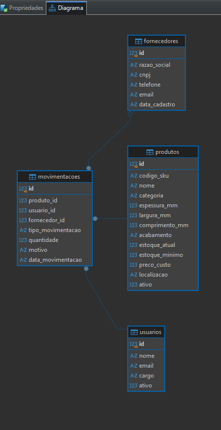
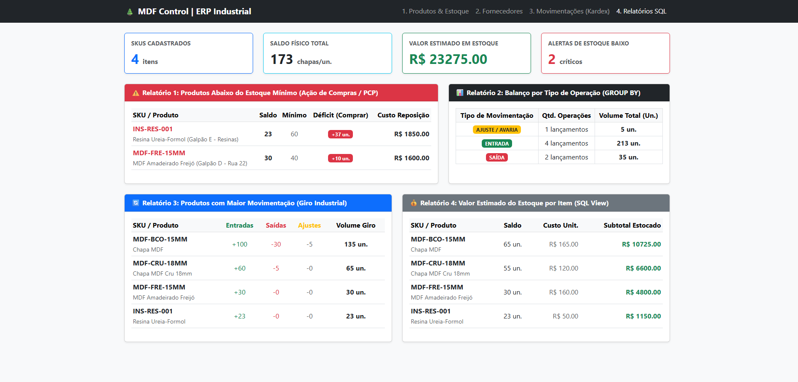
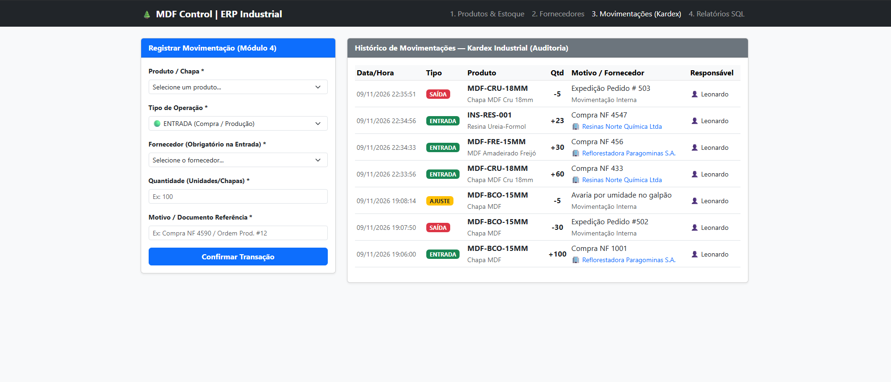
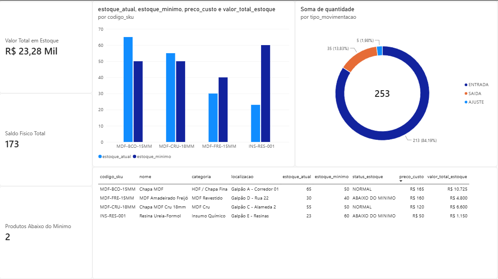

# 🌲 MDF Control — Sistema ERP de Gestão de Estoque Industrial & BI

MVP de controle de estoque industrial, rastreabilidade de movimentações (Kardex) e Business Intelligence desenvolvido em **Python (Flask)**, **SQLite** e **Power BI**, modelado para o contexto produtivo de indústrias de painéis de madeira (MDF/HDF e insumos químicos).

## 🚀 Funcionalidades Implementadas

1. **Gestão de Produtos & Parâmetros de PCP:** cadastro de chapas e insumos com controle de dimensões (espessura, largura, comprimento), acabamento, localização física no galpão e estoque mínimo.
2. **Homologação de Fornecedores (1FN):** cadastro com máscaras de validação (CNPJ e Telefone) no Frontend/Backend e cálculo automático de volume fornecido via `LEFT JOIN`.
3. **Movimentações de Estoque (Kardex Transacional):** registro de `ENTRADA`, `SAIDA` e `AJUSTE` (avarias/inventário) utilizando **Transações ACID (`commit`/`rollback`)** e bloqueio automático contra saldo negativo.
4. **Relatórios SQL & Views Analíticas:** painel gerencial com KPIs de valoração de estoque, alerta de ruptura/reposição (`WHERE estoque_atual < estoque_minimo`), giro de produtos (`CASE WHEN`) e Views dedicadas (`vw_posicao_estoque` e `vw_kardex_historico`).
5. **Dashboard Executivo no Power BI:** integração direta via script Python (`pandas`/`sqlite3`), tratamento em Power Query (ETL) e indicadores em **DAX** (`SUM`, `CALCULATE`).

## 📸 Demonstração Visual do Projeto

### 1. Modelagem Relacional — Diagrama ER (DBeaver / SQLite)


### 2. Painel Gerencial e Relatórios SQL (Web / Flask)


### 3. Controle Transacional de Movimentações — Kardex (ACID)


### 4. Dashboard Executivo (Power BI + DAX)


## 🛠️ Tecnologias Utilizadas

- **Backend:** Python 3, Flask, SQLite3
- **Banco de Dados:** SQLite (Modelagem Relacional, Foreign Keys, Constraints `CHECK`, `VIEWS`)
- **Frontend:** HTML5, Bootstrap 5, Jinja2, JavaScript (Regex Masks)
- **Business Intelligence:** Power BI Desktop, Power Query (ETL), DAX

## ▶️ Como Executar Localmente

```bash
# 1. Criar e ativar o ambiente virtual
python -m venv venv
.\venv\Scripts\Activate.ps1

# 2. Instalar dependências
pip install flask pandas matplotlib

# 3. Iniciar o servidor (o banco SQLite e as Views são inicializados automaticamente)
python app.py